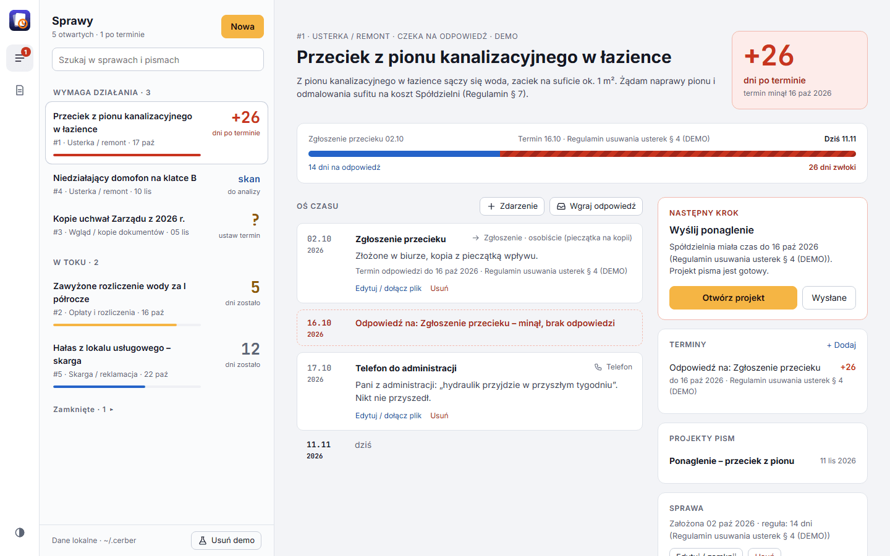
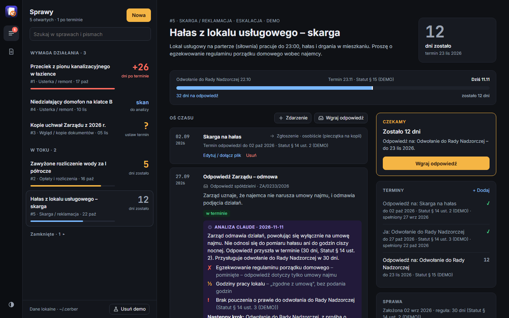

<h1> Cerber</h1>

**Cerber pilnuje spraw, które zgłaszasz jako lokator do spółdzielni mieszkaniowej.** Każda sprawa ma oś czasu – pisma, odpowiedzi, telefony, oględziny – i licznik dni do terminu odpowiedzi, wyliczonego z regulaminu spółdzielni albo ustawionego ręcznie. Gdy spółdzielnia termin przekroczy, sprawa trafia na górę listy z czerwonym **+26 dni po terminie** i gotowym następnym krokiem. Odpowiedzi spółdzielni – zwykle skany – czyta Claude przez serwer MCP: sprawdza, czy odpowiedź dotyczy wszystkich punktów pisma, czy powołane paragrafy mówią to, co twierdzi spółdzielnia, i wyłapuje zobowiązania z datami. Działa na **Twojej subskrypcji Claude, bez klucza API**, a wszystkie dane zostają na Twoim komputerze.

*Cerber keeps track of the issues a tenant raises with their Polish housing cooperative: a timeline per case, reply deadlines from the cooperative's own rules, overdue flags, and analysis of scanned replies by Claude over MCP. The app and its texts are in Polish.*



## Funkcje

- **Lista według pilności.** Sprawy są podzielone na *Wymaga działania* (po terminie, odpowiedź do analizy, brak terminu), *W toku* i *Zamknięte*. Każdy wiersz pokazuje jedną dużą liczbę: **+26** dni po terminie na czerwono, **5** dni do terminu na bursztynowo, **?** gdy brakuje terminu, **skan** gdy odpowiedź czeka na analizę – oraz pasek, ile terminu już minęło.
- **Etapy sprawy.** Szkic → czeka na odpowiedź → odpowiedź → eskalacja (ponaglenie, odwołanie do Rady Nadzorczej…) → zamknięta, z wynikiem: załatwiona, częściowo, odmowa, wycofana. Pismo do spółdzielni samo przestawia sprawę na „czeka”, jej odpowiedź – na „odpowiedź”, odwołanie – na „eskalację”.
- **Terminy liczone jak w prawie.** Od dnia złożenia lub doręczenia pisma, w dniach kalendarzowych; koniec w sobotę, niedzielę lub święto przesuwa się na następny dzień roboczy (Kodeks cywilny art. 115, z Wielkanocą, Bożym Ciałem i Wigilią od 2025 r.). Termin wynika z **reguły regulaminu** dla kategorii spraw („usterki – 14 dni, Regulamin § 4”) albo jest **ustawiany ręcznie**, gdy regulamin nic nie mówi. Cerber nigdy nie zakłada domyślnej liczby dni: sprawa bez terminu jest oznaczona i prosi o jego ustawienie.
- **Terminy w obie strony.** Odpowiedź spółdzielni spełnia otwarte terminy odpowiedzi i pokazuje, czy przyszła w terminie, czy *3 dni po terminie*. Zobowiązania z jej pism („wymiana pionu do 30.11”) i Twoje terminy – na przykład na odwołanie – są pilnowane tak samo.
- **Oś terminu.** W sprawie pasek od Twojego pisma do terminu i dalej do dziś: na niebiesko czas, który spółdzielnia miała, w czerwone paski dni zwłoki.
- **Następny krok.** Jedna karta mówi, co teraz zrobić, z jednym przyciskiem: otwórz gotowy projekt ponaglenia, skopiuj polecenie dla Claude'a („Przeanalizuj odpowiedź spółdzielni w sprawie #4”), ustaw brakujący termin, odhacz swój termin, wgraj odpowiedź.
- **Niepełne odpowiedzi i sprawy bez ruchu.** Odpowiedź, która według analizy załatwia mniej niż połowę Twoich punktów, nie odhacza terminu na zielono – widać *½ odpowiedź niepełna*, a sprawa bez dalszych terminów trafia do „Wymaga działania” z propozycją ponaglenia o brakujące punkty. Sprawa z odpowiedzią, bez terminów i bez zdarzeń od 14 dni dostaje flagę *brak następnego kroku*.
- **Skany i dokumenty.** PDF-y, zdjęcia, e-maile Outlooka (`.msg`) i inne pliki przy każdym zdarzeniu, do otwarcia jednym kliknięciem. Claude czyta z `.msg` nadawcę, adresatów, datę wysłania, treść i załączniki.
- **Regulaminy.** Statut, regulaminy i ustawy wczytane z PDF-u z warstwą tekstową, z pliku tekstowego albo wklejone – podzielone na paragrafy, z wyszukiwarką odporną na odmianę słów („terminu” znajduje „termin”). Zeskanowany regulamin bez tekstu odczytuje Claude. Nowa wersja dokumentu zastępuje starą, która zostaje dla spraw ocenianych według niej.
- **Projekty pism.** Ponaglenia i odwołania przygotowane przez Claude'a leżą w sprawie, gotowe do skopiowania i wydruku. Wysyłasz je sam, a przycisk *Wysłane* dodaje pismo na oś czasu z terminem odpowiedzi. Niewysłany projekt jest widoczny na liście spraw.
- **Demo.** *Wczytaj demo* dodaje fikcyjną spółdzielnię z regulaminem, wyciągiem ze statutu i sześcioma sprawami na każdym etapie, z datami liczonymi od dziś – jedna po terminie z gotowym ponagleniem, jedna z terminem za kilka dni, jedna bez terminu, jedna z wygenerowanym skanem odpowiedzi do analizy (powołuje się na nieistniejący § 9 – Claude powinien to wyłapać), eskalacja do Rady Nadzorczej z gotową analizą i sprawa zamknięta. *Usuń demo* usuwa tylko dane demo.
- **Jasny lub ciemny.** Przełącznik na dole paska: jak w systemie, jasny, ciemny. Wybór zostaje w przeglądarce i nie miga przy starcie.

  

## Szybki start

Wymagania: [Bun](https://bun.sh). Uruchamia serwer MCP i może uruchamiać aplikację; do aplikacji wystarczy też Node.js 20.9+.

```bash
git clone https://github.com/Torgh/cerber.git
cd cerber
bun install
bun run dev          # http://127.0.0.1:3200
# albo wersja produkcyjna: bun run build && bun run start
```

Na pustej liście kliknij **Wczytaj dane demo**, żeby zobaczyć wszystkie stany sprawy.

### Claude przez MCP (bez klucza API)

```bash
claude mcp add --scope user cerber -- ~/.bun/bin/bun /ścieżka/do/cerber/mcp/server.ts
```

W Claude Desktop dodaj to samo polecenie w `mcpServers` w jego konfiguracji. Serwer MCP czyta i zapisuje ten sam plik co aplikacja – zostaw ją otwartą, a zmiany pojawią się w ciągu kilku sekund.

Przykłady:

- „Co nowego w Cerberze?” – przegląd: po terminie, zbliżające się terminy, odpowiedzi do analizy, sprawy bez terminu.
- „Wczytaj do Cerbera statut z `C:\Dokumenty\statut.pdf` i ustal terminy odpowiedzi” – także zeskanowany; Claude zapisze reguły terminów z paragrafami.
- „Dodaj do sprawy #7 odpowiedź spółdzielni otrzymaną 20.10, skan `C:\Skany\odp.pdf`, i ją przeanalizuj.”
- „Przygotuj ponaglenie w sprawie #7.”

| Narzędzie MCP | Co robi |
|---|---|
| `get_overview`, `list_cases`, `get_case` | Przegląd, lista i cała sprawa z osią czasu, analizami i terminami |
| `create_case`, `update_case` | Nowa sprawa; tytuł, kategoria, etap, wynik |
| `add_event`, `update_event`, `attach_document` | Zdarzenia na osi czasu i pliki z dysku; pismo zakłada termin odpowiedzi z reguły kategorii albo podany `reply_deadline` |
| `read_document` | Strony skanu jako obrazy i warstwa tekstowa PDF-u (e-mail `.msg`: nagłówki, treść, załączniki), razem z kontekstem sprawy i listą rzeczy do sprawdzenia |
| `read_scan` | Dowolny plik z dysku (np. zeskanowany regulamin) bez zapisywania go |
| `save_analysis` | Analiza: punkty pisma załatwione lub nie, zastrzeżenia z paragrafami, następny krok; zobowiązania spółdzielni i Twoje terminy trafiają do terminów sprawy |
| `set_deadline` | Dodanie, zmiana, spełnienie lub odrzucenie terminu |
| `save_draft`, `send_draft` | Projekt pisma w sprawie; oznaczenie go jako wysłanego (pismo na osi czasu z terminem odpowiedzi) |
| `import_rules`, `search_rules`, `get_rules`, `set_deadline_rule` | Statut i regulaminy, wyszukiwanie paragrafów, reguły terminów dla kategorii spraw |

## Dane i prywatność

Wszystko jest lokalnie, w jednym pliku JSON:

- `~/.cerber/cerber.json` – sprawy, regulaminy, terminy i reguły,
- `~/.cerber/files/` – skany i dokumenty,
- `~/.cerber/backups/` – kopia z każdego dnia, w którym coś się zmieniło (ostatnie 30).

Inny katalog ustawisz zmienną `CERBER_DATA_DIR` (zobacz `.env.example`). Skany czyta Claude w Twojej sesji – trafiają do niego tylko wtedy, gdy o to poprosisz. Repozytorium zawiera wyłącznie kod.

## Bezpieczeństwo

Cerber to **osobista, lokalna aplikacja**:

- serwer nasłuchuje tylko na `127.0.0.1`,
- API odpowiada tylko na żądania zaadresowane do tego komputera (`Host`: `127.0.0.1` / `localhost`), co blokuje DNS rebinding – strona pod obcą domeną nie odczyta spraw ani skanów,
- zmiany danych przyjmuje tylko z własnej strony (nagłówek `Origin` z `localhost` / `127.0.0.1`), więc inna strona otwarta w przeglądarce nie może ich wysłać,
- pliki są zapisywane pod losowymi identyfikatorami i nigdy pod ścieżką podaną z zewnątrz,
- aplikacja i serwer MCP zapisują bazę po kolei (plik blokady), zapis jest atomowy (plik tymczasowy + zmiana nazwy).

Nie wystawiaj aplikacji do internetu w tej postaci.

## Jak to działa

```
app/
  page.tsx, layout.tsx         UI (Next.js 16, React 19), motyw ustawiany przed pierwszym renderem
  api/state                    cała baza; ?since= odpowiada 204, gdy nic się nie zmieniło (strona pyta co 3 s)
  api/action                   zmiany bez plików: { op, args } → funkcje z lib/ops.ts
  api/upload                   zmiany z plikami: zdarzenie ze skanem, załącznik, regulamin
  api/files/[id]               podgląd zapisanego pliku
  api/demo                     wczytanie / usunięcie danych demo
proxy.ts                       API tylko dla żądań do 127.0.0.1 / localhost
components/                    lista spraw, widok sprawy, formularze, regulaminy, ikony, motyw
mcp/server.ts                  serwer MCP (stdio) – te same operacje i ten sam plik co aplikacja
lib/
  types.ts                     model danych: sprawa, zdarzenie, termin, analiza, regulamin
  ops.ts                       wszystkie zmiany danych (wspólne dla aplikacji i MCP)
  dates.ts                     terminy: dni kalendarzowe, weekendy i święta w Polsce
  status.ts                    po terminie, zbliża się, bez terminu, do analizy, niepełna odpowiedź,
                               projekt do wysłania, bez ruchu; kolejność listy
  rules.ts                     podział regulaminu na paragrafy, wyszukiwanie
  format.ts                    sprawy jako tekst dla Claude'a
  demo.ts                      dane demo względem dzisiejszej daty
  server/db.ts                 plik JSON: blokada, zapis atomowy, kopie zapasowe
  server/files.ts, pdf.ts      pliki; tekst i obrazy stron PDF, zdjęcia przeskalowane dla Claude'a
  server/msg.ts                e-maile Outlooka (.msg): własny czytnik MS-CFB, bez zależności
  server/demo.ts               „skan” odpowiedzi spółdzielni do demo
```

## Skrypty

```bash
bun run dev            # serwer deweloperski na http://127.0.0.1:3200
bun run build          # build produkcyjny
bun run start          # uruchomienie buildu produkcyjnego
bun run mcp            # serwer MCP ręcznie (zwykle uruchamia go Claude)
bun run typecheck
bun run lint           # ESLint (reguły Next.js + TypeScript), bez ostrzeżeń
bun run test           # testy jednostkowe, API i integracyjny serwera MCP
bun run test:coverage
bun run check          # to, co CI: typecheck, lint, testy z pokryciem, build
```

`bun run typecheck` używa TypeScriptu 7 (pakiet `@typescript/native`, polecenie `tsc`). ESLint i `next build` wciąż potrzebują API TypeScriptu, którego 7.0 nie ma, więc pakiet `typescript` to wydanie zgodności TypeScript 6 (`@typescript/typescript6`), jak zaleca Microsoft, dopóki typescript-eslint nie obsługuje 7.

CI uruchamia te same kroki co `bun run check` przy każdym pull requeście i każdym commicie na `main`, do tego testy na Windows, a przy pull requeście przegląd zależności, który nie przepuści nowej zależności ze znaną poważną podatnością; pull request można scalić dopiero, gdy przejdą. Zadania są wspólne z [TripDeckiem](https://github.com/Torgh/tripdeck) i [DiveDeckiem](https://github.com/Torgh/divedeck) (`Torgh/tripdeck/.github/workflows/bun-app.yml`), więc te aplikacje sprawdzane są tak samo. CI nie przechodzi, gdy pokrycie testami spadnie poniżej progów w `vitest.config.mts`. CodeQL skanuje kod przy każdym pull requeście, na `main` i co tydzień (`.github/workflows/codeql.yml`). Dependabot co poniedziałek otwiera zgrupowane aktualizacje, a poprawki bezpieczeństwa od razu. Testy nigdy nie dotykają prawdziwych spraw: każdy używa własnego tymczasowego `CERBER_DATA_DIR`.

`bun install` ustawia hooki gita z `.githooks/`: nie pozwalają zrobić commita ani pusha, który zawiera wartość klucza, sekretu, tokenu lub hasła z Twojego `.env.local`.

## Zastrzeżenie

Cerber pomaga pilnować terminów i porządkować korespondencję, ale **nie jest poradą prawną**. Terminy wynikają ze statutu i regulaminów Twojej spółdzielni oraz z przepisów, które mogą się zmienić – sprawdź je w źródłach. Analizy Claude'a mogą zawierać błędy. W sporach o pieniądze lub prawa do lokalu skonsultuj się z prawnikiem, na przykład w punkcie nieodpłatnej pomocy prawnej w swoim powiecie.

## Licencja

Copyright © 2026 Krzysztof Liszankowski

Cerber jest wolnym oprogramowaniem: możesz go rozpowszechniać i modyfikować na warunkach
[GNU Affero General Public License](LICENSE) opublikowanej przez Free Software Foundation, w wersji 3
albo (według Twojego wyboru) dowolnej późniejszej.

Program jest rozpowszechniany w nadziei, że będzie przydatny, ale BEZ JAKIEJKOLWIEK GWARANCJI, nawet
domyślnej gwarancji PRZYDATNOŚCI HANDLOWEJ albo PRZYDATNOŚCI DO OKREŚLONYCH ZASTOSOWAŃ. Szczegóły
w GNU Affero General Public License.

Jeśli udostępniasz zmodyfikowaną wersję Cerbera jako usługę sieciową, AGPL wymaga, żebyś udostępnił
jej użytkownikom odpowiadający jej kod źródłowy.
